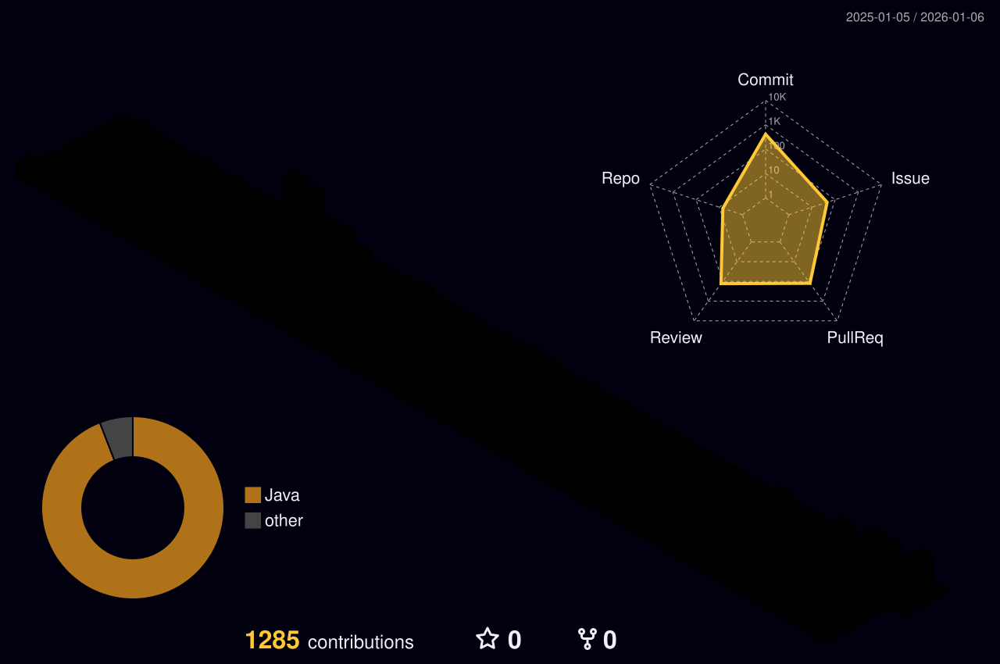

---

## About Me

```java
public class Wongil extends Developer {

    private final String location = "Incheon, Korea";
    private final String blog = "https://realits.me";
    
    @Override
    public String[] getTechStack() {
        return new String[] {
            "Java", "Spring Boot", "Spring Security",
            "JPA", "PostgreSQL",
            "Docker", "AWS", "GitHub Actions"
        };
    }
    
    @Override
    public String getCurrentFocus() {
        return "Building scalable backend systems";
    }
    
    @Override
    public String[] getLearning() {
        return new String[] {"Cloud Native", "MSA", "Kubernetes"};
    }
}
```

<br/>

<div align="center">

<!-- GitHub Streak Stats -->


</div>

<br/>

---

<div align="center">

<!-- Activity Graph -->


</div>

<br/>

---

<div align="center">

<!-- 3D Contribution Calendar - GitHub Action으로 생성됨 -->


</div>

---

<!--START_SECTION:waka-->


**🐱 My GitHub Data** 

> 📦 48.6 kB Used in GitHub's Storage 
 > 
> 🏆 1,102 Contributions in the Year 2025
 > 
> 🚫 Not Opted to Hire
 > 
> 📜 7 Public Repositories 
 > 
> 🔑 4 Private Repositories 
 > 
**I'm an Early 🐤** 

```text
🌞 Morning                4395 commits        █████░░░░░░░░░░░░░░░░░░░░   20.62 % 
🌆 Daytime                14296 commits       █████████████████░░░░░░░░   67.08 % 
🌃 Evening                2515 commits        ███░░░░░░░░░░░░░░░░░░░░░░   11.80 % 
🌙 Night                  107 commits         ░░░░░░░░░░░░░░░░░░░░░░░░░   00.50 % 
```
📅 **I'm Most Productive on Friday** 

```text
Monday                   3376 commits        ████░░░░░░░░░░░░░░░░░░░░░   15.84 % 
Tuesday                  4148 commits        █████░░░░░░░░░░░░░░░░░░░░   19.46 % 
Wednesday                3469 commits        ████░░░░░░░░░░░░░░░░░░░░░   16.28 % 
Thursday                 3533 commits        ████░░░░░░░░░░░░░░░░░░░░░   16.58 % 
Friday                   6101 commits        ███████░░░░░░░░░░░░░░░░░░   28.63 % 
Saturday                 502 commits         █░░░░░░░░░░░░░░░░░░░░░░░░   02.36 % 
Sunday                   184 commits         ░░░░░░░░░░░░░░░░░░░░░░░░░   00.86 % 
```


📊 **This Week I Spent My Time On** 

```text
🕑︎ Time Zone: Asia/Seoul

💬 Programming Languages: 
Java                     5 hrs 5 mins        ███████████████░░░░░░░░░░   60.02 % 
Bash                     1 hr 9 mins         ███░░░░░░░░░░░░░░░░░░░░░░   13.57 % 
Markdown                 1 hr 5 mins         ███░░░░░░░░░░░░░░░░░░░░░░   12.98 % 
YAML                     32 mins             ██░░░░░░░░░░░░░░░░░░░░░░░   06.40 % 
JSON                     18 mins             █░░░░░░░░░░░░░░░░░░░░░░░░   03.72 % 

🔥 Editors: 
IntelliJ IDEA            8 hrs 28 mins       █████████████████████████   100.00 % 

💻 Operating System: 
Mac                      8 hrs 28 mins       █████████████████████████   100.00 % 
```

**I Mostly Code in Java** 

```text
Java                     10 repos            ██████████████████░░░░░░░   71.43 % 
TypeScript               2 repos             ████░░░░░░░░░░░░░░░░░░░░░   14.29 % 
Astro                    1 repo              ██░░░░░░░░░░░░░░░░░░░░░░░   07.14 % 
JavaScript               1 repo              ██░░░░░░░░░░░░░░░░░░░░░░░   07.14 % 
```


**Timeline**


 Last Updated on 10/12/2025 18:57:58 UTC
<!--END_SECTION:waka-->

---

## Connect

<div align="center">

<a href="https://realits.me">
  
</a>
<a href="https://github.com/realitsyourman">
  
</a>

<br/><br/>


</div>

<!-- Footer -->

